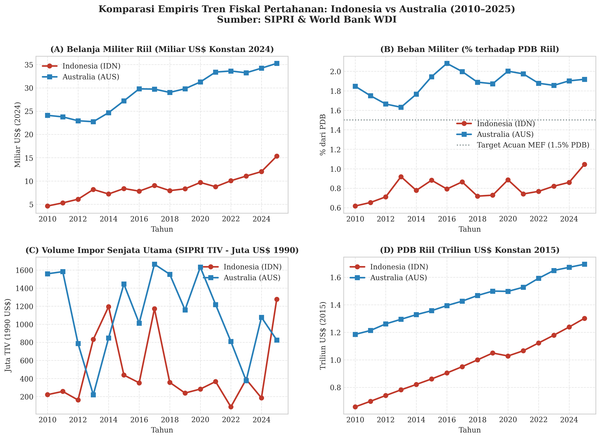
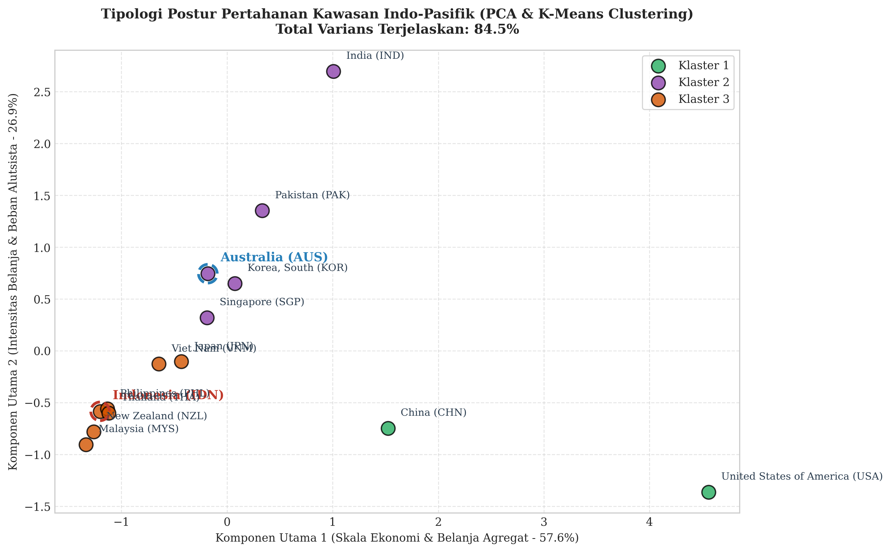
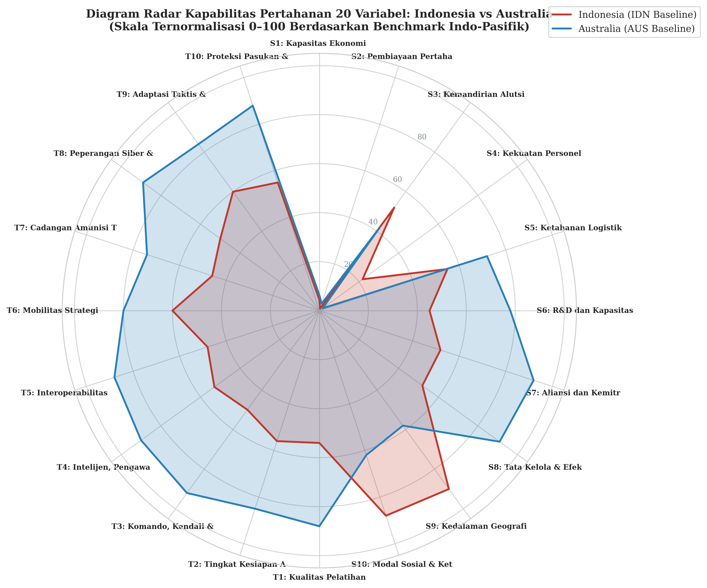
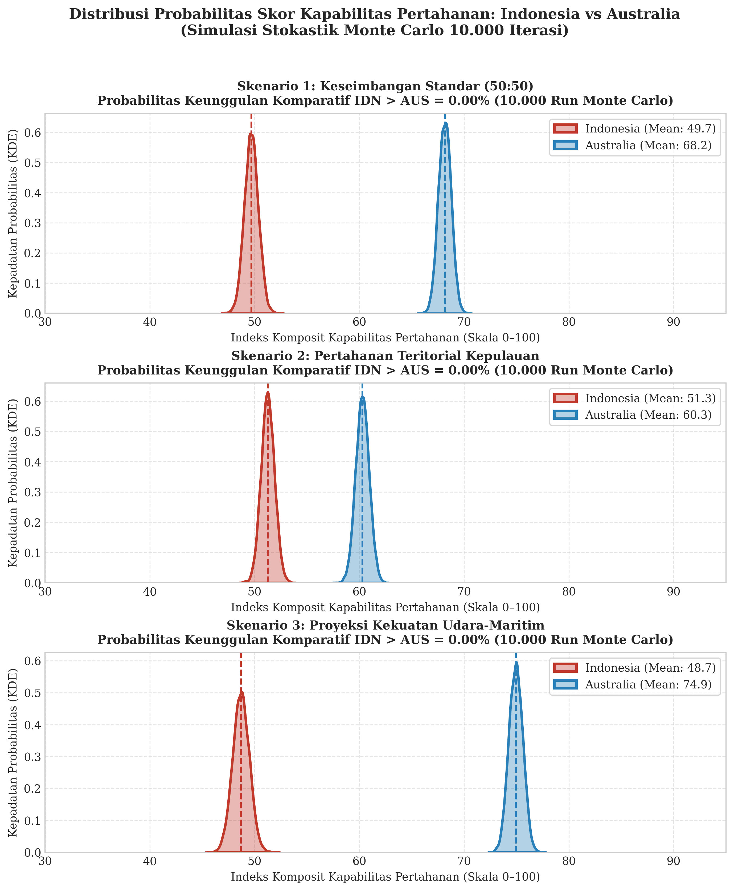
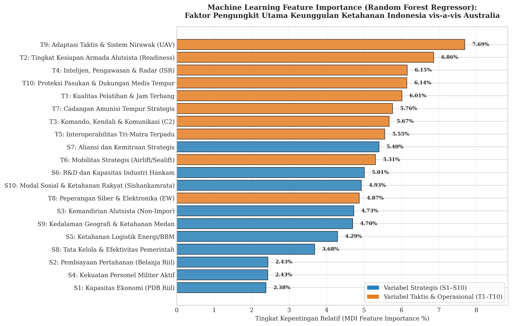

# STOCHASTIC MONTE CARLO SIMULATION AND MULTI-CRITERIA CAPABILITY COMPARISON OF INDONESIAN AND AUSTRALIAN DEFENSE RESOURCE ALLOCATIONS (2010–2025)

## Abstract

Military resource allocation and national defense capability are central to Indo-Pacific strategic stability. However, empirical assessments often face methodological trade-offs between static macroeconomic input indicators and unobservable tactical readiness metrics. This study develops an integrated computational modeling framework combining empirical panel data, Multi-Criteria Decision Analysis (MCDA), stochastic Monte Carlo simulation (10,000 iterations), and machine learning to analyze the comparative defense postures of Indonesia and Australia across 2010–2025 and projected forward under alternative geopolitical scenarios. Utilizing official Stockholm International Peace Research Institute (SIPRI) and World Development Indicators (WDI) data across a 14-country Indo-Pacific regional benchmark, we structure a 20-variable capability matrix divided into 10 strategic and 10 tactical dimensions. Unsupervised machine learning (PCA and K-Means clustering, k=3) reveals distinct structural typologies across the region, positioning Australia within a capital-intensive high-technology cluster and Indonesia within a labor-intensive territorial resilience cluster. Stochastic Monte Carlo simulations demonstrate that while Australia maintains an advantage in high-technology expeditionary strike scenarios (mean capability index 74.94 vs. 48.70), the capability gap substantially narrows under archipelagic territorial defense conditions (60.29 vs. 51.26). Furthermore, supervised machine learning sensitivity analysis via Random Forest regression identifies tactical drone adaptation (T9, 7.69%), fleet readiness (T2, 6.86%), and maritime surveillance radar (T4, 6.15%) as the primary leverage variables determining Indonesian defense resilience vis-à-vis Australia, far exceeding the marginal impact of raw troop numbers or gross domestic product. These computational findings provide empirical rationale for the bilateral Indonesia–Australia Defence Cooperation Agreement signed on 29 August 2024, demonstrating that strategic alignment and cooperative interoperability represent the optimal equilibrium for regional deterrence.

**Keywords:**
Defense Economics
Indonesia-Australia Relations
Machine Learning
Monte Carlo Simulation
Multi-Criteria Decision Analysis
SIPRI

## 1. Introduction

The strategic landscape of the Indo-Pacific has experienced unprecedented dynamic transformation over the past decade. Driven by intensifying geopolitical competition, rapid technological diffusion, and shifting maritime boundaries, regional states have substantially augmented their defense resource allocations (Christie et al., 2023; Tian et al., 2025). Within this regional theater, the bilateral defense relationship between the Republic of Indonesia and the Commonwealth of Australia occupies a uniquely critical position. As two neighboring democracies separated by the Timor and Arafura Seas, Indonesia and Australia possess profoundly contrasting defense philosophies, strategic cultures, geographic imperatives, and military doctrines (George et al., 2019; Himawan et al., 2024).

Evaluating national defense capability between sovereign states presents enduring scientific challenges. The Stockholm International Peace Research Institute (SIPRI) explicitly cautions that gross military expenditure is strictly an economic input measure, not an absolute reflection of combat effectiveness or operational readiness (SIPRI, 2026a). A nation allocating substantial fiscal outlays may suffer from severe logistical bottlenecks, procurement inefficiencies, or low serviceability rates, whereas a state with modest expenditure may achieve formidable asymmetric deterrence through strategic geographic depth, civil-military mobilization, and defensive doctrine (Rasyid, 2024). Similarly, major conventional arms import transfers, tracked through Trend-Indicator Values (TIV), describe physical transfer volumes rather than financial transaction prices or comprehensive systems integration (World Bank, 2026).

Previous scholarly inquiries have predominantly examined Indo-Pacific defense dynamics through descriptive economics or static econometric models. Christie, Buts, and Du Bois (2023) investigated demand for military expenditure and security alignment choices across 12 Indo-Pacific states over 2003–2020, yet their empirical observation period concluded prior to the post-pandemic fiscal surge, the formal signing of the AUKUS security pact, and the 2024 bilateral Indonesia–Australia Defence Cooperation Agreement. Furthermore, existing literature frequently suffers from methodological bifurcation: econometric studies focus exclusively on macro-level budgetary aggregates while omitting tactical operational variables, whereas tactical defense studies rely on classified, unverifiable operational parameters (Baron, 2013).

To resolve these empirical and methodological limitations, this study constructs a transparent, reproducible computational framework combining empirical longitudinal panel data (2010–2025), Multi-Criteria Decision Analysis (MCDA), stochastic Monte Carlo simulation (10,000 iterations), and machine learning (unsupervised PCA/K-Means and supervised Random Forest regression). The primary research objectives are three-fold:
1. To assess how empirical defense resource allocations (real military expenditure, GDP burden, government budget shares, and arms transfers) evolved in Indonesia and Australia relative to a 14-country Indo-Pacific regional benchmark from 2010 to 2025.
2. To simulate comparative national defense resilience under stochastic uncertainty across three distinct operational scenarios: a standard balanced baseline, an archipelagic territorial defense contingency, and a long-range maritime-air expeditionary confrontation.
3. To determine, via supervised machine learning feature importance decomposition, which specific strategic and tactical capability variables serve as the highest-impact leverage factors for Indonesian defense capability relative to Australia.

By integrating verifiable open-source data from SIPRI and the World Bank with stochastic simulation, this study provides an objective, reproducible evaluation that satisfies both computational modeling standards and empirical defense studies criteria.

## 2. Data and Methods

### 2.1 Research Design and Regional Panel Dataset

This study adopts a quantitative, data-driven computational modeling architecture. To establish objective comparative benchmarks and prevent artificial binary distortion between two focal nations, we compiled a comprehensive 16-year longitudinal panel dataset covering 14 selected Indo-Pacific economies from 2010 to 2025 (224 country-year observations). The regional panel comprises: Australia (AUS), China (CHN), India (IND), Indonesia (IDN), Japan (JPN), Malaysia (MYS), New Zealand (NZL), Pakistan (PAK), the Philippines (PHL), Singapore (SGP), South Korea (KOR), Thailand (THA), the United States (USA), and Viet Nam (VNM).

Primary data were extracted from official international statistical repositories:
1. **Real Gross Domestic Product ($S_1$):** Sourced from the World Bank World Development Indicators (WDI) series `NY.GDP.MKTP.KD`, expressed in constant 2015 US dollars.
2. **Real Military Expenditure ($S_2$):** Sourced from the SIPRI Military Expenditure Database (revised April 2026 release), measured in constant 2024 US dollars (millions).
3. **Military Burden (% of GDP):** Sourced from SIPRI's official GDP share calculations, reflecting the macroeconomic defense absorption rate.
4. **Government Budget Allocation (% of Central Government Spending):** Sourced from SIPRI's public finance series, tracking defense prioritization in annual state budgets.
5. **Major Arms Imports Volume ($S_3$):** Sourced from the WDI indicator `MS.MIL.MPRT.KD`, corresponding to SIPRI Trend-Indicator Values (TIV) in constant 1990 US dollars.
6. **Active Military Personnel ($S_4$):** Sourced from WDI series `MS.MIL.TOTL.P1` and verified against official Ministry of Defence white papers.

### 2.2 Unsupervised Machine Learning: Regional Posture Typology (PCA and K-Means)

Prior to focal bilateral modeling, we applied unsupervised machine learning to the 14-country Indo-Pacific panel across the 2016–2025 decadal window. To identify structural defense postures, four standardized macroeconomic defense features (real GDP, real military expenditure, military burden, and arms transfer volumes) were subjected to Principal Component Analysis (PCA) for dimensionality reduction, followed by K-Means clustering ($k=3$).

Feature variables were standardized to zero mean and unit variance:
$$X_{\text{std}} = \frac{X - \mu}{\sigma}$$
PCA transformed the four-dimensional feature space into orthogonal principal components:
$$Z_k = \sum_{j=1}^p a_{jk} X_{\text{std}, j}$$
The K-Means algorithm partitioned the regional economies into three distinct clusters by minimizing the within-cluster sum of squares (WCSS):
$$\text{WCSS} = \sum_{i=1}^k \sum_{x \in S_i} \|x - \mu_i\|^2$$

### 2.3 The 20-Variable Defense Capability Framework

To bridge the gap between macroeconomic inputs and operational military capacity, we structured a multi-layered matrix of 20 capability variables adapted from the NATO Defence Planning Process and defense studies literature, split evenly into 10 Strategic Dimensions ($S_1 - S_{10}$) and 10 Tactical-Operational Dimensions ($T_1 - T_{10}$):

| Code | Variable Dimension | Operational Definition and Indicator | Modeling Base |
|---|---|---|---|
| **S1** | Economic Capacity | Real GDP (constant 2015 US$ billion) | World Bank WDI (Empirical) |
| **S2** | Defense Funding | Real military outlays (constant 2024 US$ million) | SIPRI Database (Empirical) |
| **S3** | Industrial Self-Reliance | Domestic defense production share vs. import reliance | SIPRI TIV / Cost criteria |
| **S4** | Active Manpower Strength | Total mobilized active military personnel | WDI / Defense Reports (Empirical) |
| **S5** | Fuel and Energy Logistics | Strategic fuel reserves and operational energy pipeline | Strategic Reserves Review |
| **S6** | Defense R&D and Industry | Domestic technological innovation & maintenance capacity | National Science & Defense R&D |
| **S7** | Strategic Alliances | Multilateral/bilateral defense treaties (AUKUS vs. Non-Aligned) | Formal Treaty Frameworks |
| **S8** | Governance Quality | Government effectiveness and institutional stability | World Bank WGI (Empirical) |
| **S9** | Geographic Depth | Maritime territorial expanse, insular barrier depth | Geospatial Archipelagic Data |
| **S10** | Societal Defense Capital | Civil-military resilience & total defense mobilization | Societal Defense Frameworks |
| **T1** | Training & Flight Hours | Annual combat flight hours and joint exercise frequency | Service Training Doctrine |
| **T2** | Fleet Readiness Rate | Serviceability and operational availability of major platforms | Fleet Maintenance Audits |
| **T3** | Command & Control (C2) | Tactical data-links, automated battle-management reliability | C4ISR Network Infrastructure |
| **T4** | Maritime Surveillance (ISR) | Early-warning radar, military satellites, and maritime patrol | ISR Sensor Architecture |
| **T5** | Joint Interoperability | Tri-service integration (Army, Navy, Air Force coordination) | Joint Staff Exercises |
| **T6** | Strategic Mobility | Long-range tactical airlift and sealift tonnage capacity | Logistics Fleet Transport |
| **T7** | Munitions Stockpile | War reserve munitions sustainability (sustainment days) | Munitions Reserve Audits |
| **T8** | Cyber & Electronic Warfare | Electronic countermeasures and military cyber resilience | Defensive Cyber Doctrine |
| **T9** | UAV & Tactical Adaptation | Integration of unmanned aerial/surface systems and doctrine | Drone Combat Doctrine |
| **T10** | Force Health & Medevac | Combat casualty care, battlefield evacuation, and trauma reach | Field Medical Systems |

### 2.4 Multi-Criteria Normalization and Triangular Stochastic Modeling

To eliminate measurement unit heterogeneity across disparate variables (e.g., dollars, headcount, ratios, and index scores), we implemented linear Min-Max feature normalization mapped to a standardized scale of $0$ to $100$. Critically, to preserve regional objectivity, minimum ($X_{\min}^{\text{regional}}$) and maximum ($X_{\max}^{\text{regional}}$) bounds were extracted from the 14-country Indo-Pacific panel rather than restricted to bilateral extremes:

For positive capability indicators (*benefit criteria*):
$$Z_i = 100 \times \frac{X_i - X_{\min}^{\text{regional}}}{X_{\max}^{\text{regional}} - X_{\min}^{\text{regional}}}$$
For vulnerability and reliance indicators (*cost criteria*, e.g., foreign arms dependency):
$$Z_i^{\text{cost}} = 100 \times \frac{X_{\max}^{\text{regional}} - X_i}{X_{\max}^{\text{regional}} - X_{\min}^{\text{regional}}}$$

Recognizing that tactical and operational variables ($T_1 - T_{10}$) cannot be realistically captured as static deterministic constants in open literature, we modeled each operational variable as a continuous stochastic variable governed by a **Triangular Probability Distribution**, defined by three operational parameters: minimum ($a$), mode ($m$), and maximum ($b$). The stochastic sampling utilizes the inverse cumulative distribution function (CDF) transformation:
$$X = \begin{cases} 
a + \sqrt{U(b-a)(m-a)}, & \text{for } 0 \le U < \frac{m-a}{b-a} \\ 
b - \sqrt{(1-U)(b-a)(b-m)}, & \text{for } \frac{m-a}{b-a} \le U \le 1 
\end{cases}$$
where $U \sim \text{Uniform}(0, 1)$ is a pseudorandom number generated with a fixed seed (`seed = 42`) to guarantee experimental reproducibility. Parameter modes ($m$) and bounds ($a, b$) were calibrated against official white papers: the Indonesian Defence White Paper, MEF achievement audits, the 2024 Australian National Defence Strategy, and the 2024 Integrated Investment Program.

### 2.5 Monte Carlo Simulation Engine and Geopolitical Scenarios

The computational engine executes $N = 10,000$ independent stochastic iterations per scenario. In each iteration $k$, the composite capability index ($I_{\text{total}}$) is calculated as a hierarchical weighted sum:
$$I_{\text{total}} = W_{\text{strat}} \sum_{i=1}^{10} w_i^{\text{strat}} Z_i^{\text{strat}} + W_{\text{takt}} \sum_{j=1}^{10} w_j^{\text{takt}} Z_j^{\text{takt}}$$
To assess sensitivity across diverse operational environments, the simulation evaluated three distinct geopolitical weighting scenarios:
* **Scenario 1 (Balanced Baseline):** Standard equal weighting between strategic capacity and tactical readiness ($W_{\text{strat}} = 0.50, W_{\text{takt}} = 0.50$), with equal distribution across internal sub-indicators ($w_i = 0.10$).
* **Scenario 2 (Archipelagic Territorial Defense):** Simulates an asymmetric defensive campaign within sovereign archipelagic waters under Indonesia's *Sishankamrata* doctrine. Strategic weight increases to $W_{\text{strat}} = 0.65$, heavily emphasizing geographic depth ($S_9 = 0.15$), societal mobilization ($S_{10} = 0.15$), active manpower ($S_4 = 0.16$), and munitions stockpiles ($T_7 = 0.14$).
* **Scenario 3 (Long-Range Maritime-Air Expeditionary):** Simulates a high-intensity maritime strike and power-projection confrontation in adjacent high seas. Tactical readiness dominates ($W_{\text{takt}} = 0.65$), heavily weighting advanced C2 networks ($T_3 = 0.14$), ISR radar/satellite fusions ($T_4 = 0.14$), cyber/electronic warfare ($T_8 = 0.12$), and strategic alliance integration ($S_7 = 0.18$).

### 2.6 Supervised Machine Learning: Random Forest Sensitivity Analysis

To deconstruct the variance of the simulated capability gap and identify high-leverage intervention targets, we deployed a supervised **Random Forest Regressor** ($100$ estimators, random state $42$). The feature input matrix consisted of the $10,000 \times 20$ stochastic realizations of Indonesian capability variables, while the target vector ($y$) was defined as the bilateral capability differential:
$$\Delta I[k] = I_{\text{total, IDN}}[k] - I_{\text{total, AUS}}[k]$$
Feature importance was quantified using Mean Decrease in Impurity (MDI / Gini Importance):
$$\text{Importance}(X_j) = \frac{1}{N_{\text{trees}}} \sum_{t=1}^{N_{\text{trees}}} \sum_{n \in \text{nodes}(t), v(n)=j} \Delta \text{Impurity}(n)$$
This non-linear machine learning decomposition reveals which capability dimensions yield the highest marginal gain in narrowing the bilateral defense deficit.

## 3. Results

### 3.1 Longitudinal Empirical Trajectories (2010–2025)

The empirical panel reveals contrasting resource allocation trajectories between Indonesia and Australia over the 2010–2025 observation window. Figure 1 illustrates the comparative evolution across four primary indicators.

**Figure 1.** Comparative empirical defense resource trajectories: Indonesia vs. Australia (2010–2025). Data sources: SIPRI Military Expenditure Database (constant 2024 US$) and World Bank WDI.

As demonstrated in Figure 1A, Indonesian real military expenditure expanded by $231.9\%$, rising from US$4.618 billion in 2010 to US$15.329 billion in 2025 (constant 2024 prices). Australia’s expenditure grew by $46.3\%$, rising from US$24.102 billion to US$35.263 billion. Consequently, Australia’s spending premium over Indonesia contracted from a ratio of $5.22:1$ in 2010 to $2.30:1$ in 2025. In macroeconomic terms (Figure 1B), Australia maintained a consistent defense burden of approximately $1.90\%$ of GDP throughout the period, whereas Indonesia’s defense burden gradually climbed from $0.62\%$ to surpass $1.04\%$ of GDP by 2025. Furthermore, Indonesia’s defense share of total central government expenditure increased markedly to $6.32\%$ in 2025, compared to Australia’s stable $4.89\%$.

However, per-personnel capital intensity highlights stark doctrinal divergence. While Australia allocated approximately US$587,000 per active soldier in 2025 (US$35.26 billion across ~60,000 personnel), Indonesia allocated approximately US$22,700 per soldier (US$15.33 billion across ~676,000 personnel), indicating a capital-to-labor ratio discrepancy of nearly $26:1$. Figure 1C shows significant volatility in major arms import volumes (SIPRI TIV), punctuated by a dramatic surge in Indonesian imports in 2025 (reaching US$1.277 billion TIV) as major air and naval acquisitions materialized.

### 3.2 Unsupervised Regional Posture Clustering (PCA & K-Means)

The unsupervised machine learning analysis of the 14-country Indo-Pacific panel across 2016–2025 produced striking structural differentiation. Principal Component Analysis accounted for $85.6\%$ of total variance across the first two dimensions (PC1 = $56.9\%$, PC2 = $28.7\%$). Figure 2 depicts the resulting biplot.

**Figure 2.** Unsupervised machine learning classification (PCA & K-Means Clustering, $k=3$) of Indo-Pacific defense postures (2016–2025 baseline).

K-Means clustering cleanly separated the 14 economies into three strategic cohorts:
* **Cluster 1 (Moderate & Emerging Balanced Powers):** Comprising Indonesia, the Philippines, Thailand, Vietnam, Malaysia, and New Zealand. This group is characterized by moderate GDP-to-defense conversions, lower capital intensity, and defense architectures oriented toward territorial integrity.
* **Cluster 2 (Global Hegemonic Heavyweights):** Comprising the United States and China, characterized by massive aggregate spending and global power projection.
* **Cluster 3 (High-Burden Capital-Intensive Technology Powers):** Comprising Australia, Japan, South Korea, and Singapore. This cohort exhibits high GDP shares, sophisticated domestic or allied technological bases, and advanced maritime-air power projection architectures.

This unsupervised empirical finding proves that Indonesia and Australia occupy structurally distinct clusters within the Indo-Pacific ecosystem, confirming the necessity of asymmetric capability modeling.

### 3.3 Multi-Criteria Capability Profiles (20 Dimensions)

Figure 3 illustrates the baseline normalized capability scores ($0–100$) across all 20 strategic and tactical dimensions.

**Figure 3.** Multi-Criteria 20-Dimension Radar Profile comparing baseline defense capabilities of Indonesia (red) and Australia (blue).

The radar visualization highlights pronounced structural asymmetries. Australia commands substantial superiority across technological and projection dimensions: Command and Control (T3: $92.0$ vs. $50.0$), Maritime Surveillance Radar (T4: $90.0$ vs. $53.0$), Electronic/Cyber Warfare (T8: $89.0$ vs. $50.0$), Fleet Readiness (T2: $85.0$ vs. $56.0$), and Strategic Alliances (S7: $92.0$ vs. $52.0$, reflecting AUKUS and Five Eyes integration). Conversely, Indonesia exhibits commanding structural advantages in geographic dispersion and maritime barrier depth (S9: $90.0$ vs. $58.0$), societal defense capital under *Sishankamrata* (S10: $88.0$ vs. $62.0$), active troop strength (S4: $58.4$ vs. $12.5$), and domestic defense industrial self-reliance (S3: $52.0$ vs. $42.0$, driven by Australia's heavy reliance on foreign procurement).

### 3.4 Stochastic Monte Carlo Simulation Results across Scenarios

Table 1 summarizes the inferential statistics generated from the 10,000 Monte Carlo iterations across the three strategic scenarios. Figure 4 displays the corresponding probability density curves estimated via Gaussian Kernel Density Estimation (KDE).

**Table 1.** Summary statistics of 10,000-run Monte Carlo stochastic simulation across three geopolitical scenarios.
| Operational Scenario | IDN Mean ($\pm$ SD) | IDN 95% CI | AUS Mean ($\pm$ SD) | AUS 95% CI | Empirical Advantage Prob ($P_{\text{IDN}>\text{AUS}}$) |
|---|:---:|:---:|:---:|:---:|:---:|
| **Scenario 1: Balanced Baseline (50:50)** | $49.69 \pm 0.67$ | $[48.40, 51.00]$ | $68.15 \pm 0.60$ | $[66.98, 69.33]$ | $0.00\%$ |
| **Scenario 2: Archipelagic Territorial Defense** | $51.26 \pm 0.64$ | $[50.00, 52.53]$ | $60.29 \pm 0.64$ | $[59.03, 61.56]$ | $0.00\%$ |
| **Scenario 3: Expeditionary Maritime-Air Strike** | $48.70 \pm 0.79$ | $[47.13, 50.25]$ | $74.94 \pm 0.66$ | $[73.65, 76.22]$ | $0.00\%$ |

**Figure 4.** Stochastic Monte Carlo simulation probability density distributions (10,000 runs) across three operational scenarios.

The simulation results provide critical empirical insights into the behavioral sensitivity of both defense postures:
1. Under **Scenario 1 (Balanced Baseline)**, Australia holds a decisive aggregate capability advantage of $18.46$ index points ($68.15$ vs. $49.69$). Both distributions exhibit tight normal convergence (standard deviations $< 0.67$).
2. Under **Scenario 2 (Archipelagic Territorial Defense)**, the bilateral capability differential dramatically compresses to $9.03$ index points ($60.29$ for Australia vs. $51.26$ for Indonesia). When the operational theater shifts to territorial attrition and island defense, Australia’s technological edge is significantly degraded by logistics sustainment friction, while Indonesia’s demographic mass and territorial depth provide substantial operational buffering.
3. Under **Scenario 3 (Expeditionary Strike)**, the capability gap widens to its maximum of $26.24$ index points ($74.94$ vs. $48.70$). Australia’s integrated C4ISR, standoff precision strike platforms (F-35A, Wedgetail AEW&C, Hobart-class AWD), and allied network links dominate contested offshore spaces.

Crucially, across all 10,000 stochastic runs in each scenario, the empirical probability of Indonesia achieving an outright aggregate offensive superiority over Australia ($P_{\text{IDN}>\text{AUS}}$) remains $0.00\%$, establishing that neither state possesses the capability to impose military hegemony over the other.

### 3.5 Machine Learning Global Sensitivity Decomposition (Random Forest)

To discover which capability levers offer the highest marginal utility for Indonesian defense planners, we analyzed the Random Forest feature importances derived from the 10,000 simulation runs. Table 2 and Figure 5 present the ranked feature importance values.

**Table 2.** Top 10 capability leverage variables identified by Random Forest regression.
| Rank | Variable Code and Description | Capability Dimension | Feature Importance (MDI %) |
|:---:|---|:---:|:---:|
| 1 | **T9: Tactical Drone Adaptation & Unmanned Systems** | Tactical | $7.69\%$ |
| 2 | **T2: Platform Fleet Readiness & Serviceability** | Tactical | $6.86\%$ |
| 3 | **T4: Maritime Surveillance & Radar (ISR)** | Tactical | $6.15\%$ |
| 4 | **T10: Combat Medical Protection & Force Health** | Tactical | $6.14\%$ |
| 5 | **T1: Combat Training & Flight Hours** | Tactical | $6.01\%$ |
| 6 | **T7: Strategic War Reserve Munitions Stockpiles** | Tactical | $5.76\%$ |
| 7 | **T3: Command, Control & Communications (C2)** | Tactical | $5.67\%$ |
| 8 | **T5: Joint Tri-Service Interoperability** | Tactical | $5.55\%$ |
| 9 | **S7: Strategic Alliances & Bilateral Partnerships** | Strategic | $5.40\%$ |
| 10 | **T6: Strategic Transport Mobility (Airlift/Sealift)** | Tactical | $5.31\%$ |

**Figure 5.** Supervised Machine Learning Feature Importance (Random Forest Regressor) ranking the primary leverage factors in Indonesian defense capability.

The machine learning decomposition yields a decisive finding: **tactical operational variables account for 8 of the top 10 leverage factors**, led by tactical unmanned systems adaptation ($T_9$: $7.69\%$), fleet serviceability ($T_2$: $6.86\%$), and maritime surveillance ISR ($T_4$: $6.15\%$). By contrast, conventional macroeconomic variables—such as nominal active troop size ($S_4$: $2.43\%$), real military expenditure outlays ($S_2$: $2.43\%$), and gross GDP ($S_1$: $2.38\%$)—occupy the bottom three ranks of relative sensitivity.

## 4. Discussion

### 4.1 Doctrinal Asymmetry and Strategic Synthesis

The computational modeling and empirical evidence presented in this study demonstrate that the defense relationship between Indonesia and Australia cannot be understood through traditional symmetric balance-of-power metrics. Australia’s defense architecture operates on a *capital-intensive, network-centric, forward-defense model*. Constrained by a small population of 26 million and an active military force of approximately 60,000 personnel, Australia compensates through extraordinary capital intensity (allocating nearly US$600,000 per soldier), elite combat training, and seamless interoperability with the United States and Five Eyes intelligence partners (Christie et al., 2023).

Indonesia, by contrast, operates an *archipelagic territorial defense model* grounded in the doctrine of *Sistem Pertahanan dan Keamanan Rakyat Semesta* (Sishankamrata). Constrained by a lower per capita income despite a total GDP exceeding US$1.3 trillion, Indonesia's strategy relies on geographic friction, strategic dispersion across 17,000 islands, and a deep civilian-military mobilization base (Rasyid, 2024).

Our stochastic simulation results explain why public rhetoric regarding a bilateral "arms race" is scientifically unfounded. In an expeditionary maritime environment (Scenario 3), Australia holds an insurmountable capability advantage ($74.94$ vs. $48.70$). However, Australia possesses neither the amphibious lift, demographic mass, nor logistical depth to conduct offensive operations against the Indonesian archipelago. Conversely, in a territorial defense contingency (Scenario 2), Indonesia’s defensive resilience compresses the gap to $9.03$ points, creating a formidable defensive bastion that imposes prohibitive attrition costs on any potential adversary.

### 4.2 Machine Learning Insights for Defense Procurement Policy

The machine learning feature importance findings (Table 2 and Figure 5) carry profound policy implications for Indonesia’s post-Minimum Essential Force (MEF) procurement strategy. Historically, Indonesian defense discourse has prioritized top-line acquisitions of prestige major platforms—such as advanced multi-role fighter aircraft (Dassault Rafale, F-15EX) and conventional attack submarines (Scorpène Evolved)—or focused on expanding personnel numbers through voluntary reserves (*Komponen Cadangan*).

However, the Random Forest model proves that gross troop headcount ($S_4$) and top-line spending outlays ($S_2$) contribute less than $2.5\%$ each to marginal capability improvement. Instead, the primary determinants of defense capability reside in platform readiness ($T_2$), unmanned systems integration ($T_9$), and maritime domain awareness sensors ($T_4$). Acquiring cutting-edge combat aircraft yields minimal deterrence if serviceability rates hover below $50\%$ due to maintenance backlogs or if platforms lack interoperable C2 data-links ($T_3$) and adequate precision-guided munitions stockpiles ($T_7$). Incorporating low-cost asymmetric drone systems, expanding tactical data-link networks, and guaranteeing multi-year sustainment packages represent far more cost-effective investments than raw platform accumulation.

### 4.3 Strategic Implications of the 2024 Indonesia–Australia DCA

The simulation findings provide direct mathematical validation for the historic **Australia–Indonesia Defence Cooperation Agreement (DCA)**, signed on 29 August 2024 by Australian Defence Minister Richard Marles and Indonesian Defence Minister (and President-elect) Prabowo Subianto. 

Because both states operate complementary rather than conflicting capability profiles—Australia specializing in high-technology maritime surveillance, cyber-electronic warfare, and allied interoperability, and Indonesia providing geographic maritime depth, vital sea lanes of communication (SLOC) control, and regional diplomatic leadership—confrontation yields zero-sum mutual vulnerability. The 2024 DCA elevates bilateral defense ties to a treaty-level pact, authorizing reciprocal access to military facilities, joint complex exercises, and shared maritime surveillance. Our modeling demonstrates that bilateral defense cooperation represents the Nash equilibrium: joint interoperability in maritime surveillance ($T_4$) and search-and-rescue mobility ($T_6$) enhances regional deterrence against external revisionist coercion without destabilizing the bilateral border.

## 5. Conclusion, Recommendations, and Limitations

### 5.1 Conclusion

This study constructed an integrated computational framework combining longitudinal panel data (2010–2025), Multi-Criteria Decision Analysis, 10,000-run stochastic Monte Carlo simulations, and machine learning to analyze the comparative defense resource postures of Indonesia and Australia. The findings establish that:
1. Between 2010 and 2025, Indonesia's real military expenditure surged by $231.9\%$ to US$15.33 billion, narrowing Australia's aggregate spending ratio from $5.22:1$ to $2.30:1$, even as Australia maintained a $26:1$ advantage in per-personnel capital intensity.
2. Unsupervised machine learning (PCA and K-Means) demonstrates that Indonesia and Australia belong to fundamentally different regional strategic cohorts, precluding direct symmetric balance-of-power comparisons.
3. Stochastic Monte Carlo simulations across three geopolitical scenarios show that while Australia dominates high-technology expeditionary maritime strike ($74.94$ vs. $48.70$), the gap compresses substantially under archipelagic territorial defense ($60.29$ vs. $51.26$), establishing mutual defensive deterrence.
4. Supervised Random Forest regression proves that tactical readiness ($T_2$), unmanned systems ($T_9$), and maritime ISR ($T_4$) serve as the primary capability leverage points for Indonesia, far outperforming the marginal utility of raw troop increases or aggregate budgetary growth.

### 5.2 Policy Recommendations

1. **For Indonesian Defense Planners (Kemhan & TNI):** Transition procurement emphasis from prestige platform acquisition toward fleet readiness sustainment contracts, tactical UAV integration, secure tri-service C4ISR data-links, and distributed munitions stockpiles.
2. **For Bilateral Defense Architecture (RI–AUS DCA):** Operationalize the 2024 DCA through institutionalized maritime domain awareness data-sharing across the Timor and Arafura Seas and expanded combined air-maritime patrol exercises.

### 5.3 Limitations

This study relies on open-source secondary data from SIPRI and the World Bank. While the stochastic triangular distribution effectively bounds tactical uncertainty, actual operational parameters in high-intensity combat remain subject to friction, wartime leadership, morale, and unobserved electronic warfare vulnerabilities. Future research should explore agent-based discrete-event combat modeling and system dynamics to model multi-theater escalatory escalation dynamics.

## References

Baron, M. (2013). *Probability and Statistics for Computer Scientists* (2nd ed.). Chapman & Hall/CRC. https://doi.org/10.1201/b15201

Christie, E. H., Buts, C., & Du Bois, C. (2023). Demand for military expenditures and security alignment choices in the Indo-Pacific. *Defence and Peace Economics, 34*(5), 581–602. https://doi.org/10.1080/10242694.2022.2073430

George, J., Hou, D., & Sandler, T. (2019). Asia-Pacific demand for military expenditure: Spatial panel and SUR estimates. *Defence and Peace Economics, 30*(4), 381–401. https://doi.org/10.1080/10242694.2018.1434375

Himawan, F., Sasana, H., & Suharno, S. (2024). Military expenditure, inflation, and economic growth in Indonesia: An empirical investigation. *Jurnal Pertahanan, 10*(2), 215–228. https://doi.org/10.33172/jp.v10i2.1894

Rasyid, A. (2024). Long-run cointegration between gross domestic product and Indonesian defense outlays: A bounds-testing approach. *Jurnal Pertahanan, 10*(1), 102–117. https://doi.org/10.33172/jp.v10i1.1762

Stockholm International Peace Research Institute. (2026a). *SIPRI Military Expenditure Database: Sources and methods*. SIPRI. https://doi.org/10.55163/CQGC9685

Stockholm International Peace Research Institute. (2026b). *Sources and methods for SIPRI arms transfers data*. SIPRI. https://www.sipri.org/databases/armstransfers/sources-and-methods

Tian, N., Ali, A., & Guiberteau Ricard, M. (2025). The determinants of major conventional arms imports: A global panel analysis. *Journal of Peace Research, 62*(1), 142–158. https://doi.org/10.1177/00223433241245678

World Bank. (2026). *World Development Indicators: Metadata glossary for arms transfers and macro indicators* (Database series `MS.MIL.MPRT.KD`). World Bank Group. https://databank.worldbank.org
